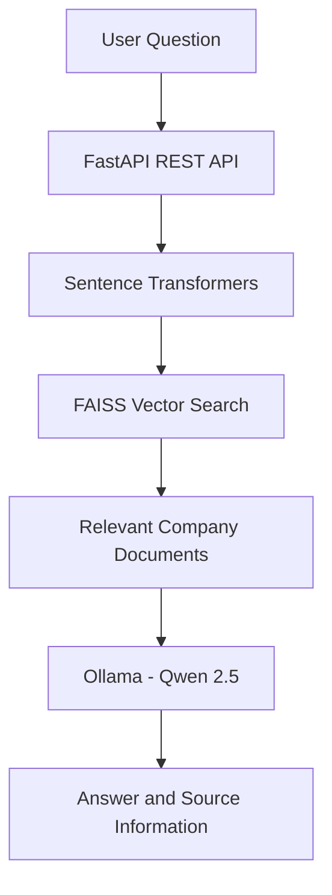
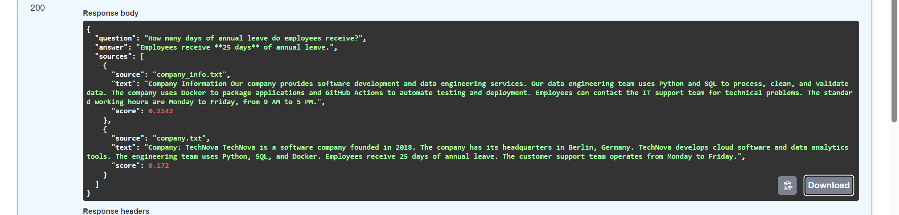

# Enterprise RAG Assistant

A Retrieval-Augmented Generation (RAG) application that answers questions using company documents. It combines semantic search with a locally running Large Language Model (LLM) to provide context-aware answers with source information.

## Features

- **Document-based Question Answering:** Answers questions using company information stored in text files.
- **Semantic Search:** Uses Sentence Transformers to convert text into embeddings.
- **Vector Search:** Uses FAISS to retrieve relevant document content.
- **Local LLM Integration:** Uses Ollama with the Qwen 2.5 model to generate answers.
- **REST API:** Built with FastAPI.
- **API Documentation:** Interactive API documentation through Swagger UI.
- **Docker Support:** Run the application in a Docker container.
- **Docker Compose:** Simplifies application startup and configuration.
- **Automated Testing:** Includes tests using pytest.
- **Continuous Integration:** GitHub Actions runs automated checks.

## Architecture



## Demo

The screenshot below shows the RAG assistant answering a question and displaying its retrieved sources through the FastAPI interface.



## How It Works

1. Company documents are stored in the `data/` directory.
2. The application processes document text and creates embeddings.
3. FAISS searches for content relevant to the user's question.
4. The retrieved context is passed to the local Ollama language model.
5. The model generates an answer based on the retrieved context.
6. FastAPI returns the answer and source information to the user.

## Technology Stack

| Technology | Purpose |
|---|---|
| Python | Main programming language |
| FastAPI | REST API development |
| Sentence Transformers | Text embeddings |
| FAISS | Vector similarity search |
| Ollama | Local language model execution |
| Qwen 2.5 | Language model |
| pytest | Automated testing |
| Docker | Application containerization |
| Docker Compose | Container configuration and startup |
| Git and GitHub | Version control and source code hosting |
| GitHub Actions | Continuous integration |

## Project Structure

```text
enterprise-rag-assistant/
+-- app/
|   +-- main.py
|   +-- rag.py
+-- data/
|   +-- company_info.txt
+-- tests/
+-- .github/
|   +-- workflows/
|       +-- ci.yml
+-- Dockerfile
+-- docker-compose.yml
+-- requirements.txt
+-- README.md
+-- .gitignore
```
## Getting Started

### Prerequisites

Install or configure the following:

- Python 3.12
- Docker Desktop
- Ollama
- Git

### 1. Clone the Repository

```bash
git clone https://github.com/malikdk1012/enterprise-rag-assistant.git
cd enterprise-rag-assistant
```

### 2. Create and Activate a Virtual Environment

On Windows PowerShell:

```powershell
python -m venv .venv
.\.venv\Scripts\Activate.ps1
```

### 3. Install Dependencies

```powershell
python -m pip install --upgrade pip
pip install -r requirements.txt
```

### 4. Configure Ollama

Install Ollama and download the model:

```bash
ollama pull qwen2.5:0.5b
```

Make sure Ollama is running and accessible to the application.

### 5. Start the Application

For local development, use the command configured for your FastAPI application. If the application object is `app` in `app/main.py`, run:

```bash
uvicorn app.main:app --reload
```

Open the API documentation at:

`http://127.0.0.1:8000/docs`

## Running with Docker Compose

Make sure Docker Desktop is running and Ollama is available on your host machine.

Build and start the application:

```powershell
docker compose up -d --build
```

View running containers:

```powershell
docker compose ps
```

View application logs:

```powershell
docker compose logs -f app
```

Stop the application:

```powershell
docker compose down
```

The Docker Compose configuration uses `host.docker.internal` to allow the container to reach Ollama running on the host machine.

## API Endpoints

| Method | Endpoint | Description |
|---|---|---|
| GET | `/` | Application welcome or status response |
| GET | `/health` | Health check |
| GET | `/search?question=your_question` | Retrieve relevant context and generate an answer |
| GET | `/docs` | Interactive API documentation |

### Example Request

```powershell
Invoke-RestMethod -Uri "http://127.0.0.1:8000/search?question=What%20programming%20language%20does%20the%20team%20use%3F"
```

The response contains the generated answer and source information, according to the application's implementation.

## Evaluation

The RAG assistant was evaluated using 15 questions against the local API.

- **Questions tested:** 15
- **Keyword-based checks passed:** 15/15 in the recorded run
- **API errors:** 0
- **Results file:** `evaluation_results.csv`

The result is a preliminary keyword-matching pass rate, not independently verified answer accuracy. Answers and source documents should also be reviewed manually. Results may vary between runs because the application uses an AI service.

## Testing
Run automated tests using:

```powershell
python -m pytest -v
```

## Continuous Integration

GitHub Actions runs the project's configured automated checks whenever changes are pushed or a pull request is opened. The workflow helps catch issues before changes are merged.

## Future Improvements

- Support PDF, DOCX, and other document formats.
- Add document upload functionality.
- Improve chunking and retrieval quality.
- Add conversation history.
- Implement authentication and access control.
- Add evaluation metrics for retrieval and answer quality.
- Deploy the application to a cloud platform.

## Learning Outcomes

This project demonstrates practical experience with:

- Building REST APIs with FastAPI.
- Implementing semantic search and vector retrieval.
- Integrating a locally hosted language model.
- Working with Docker and Docker Compose.
- Writing automated tests.
- Using GitHub Actions for continuous integration.

## Author

**Deepak Kumar Malik**

GitHub: [malikdk1012](https://github.com/malikdk1012)

---

*Built as a hands-on project to explore Retrieval-Augmented Generation, semantic search, and local LLM integration.*
